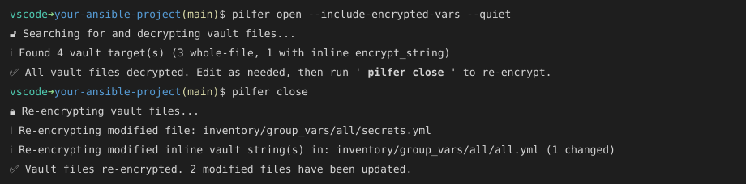

[](https://github.com/aioue/pilfer/actions/workflows/ci.yml)
[](https://github.com/aioue/pilfer/actions/workflows/test.yml)
[](https://github.com/aioue/pilfer/actions/workflows/github-code-scanning/codeql)
[](https://github.com/aioue/pilfer/network/updates)
[](https://www.python.org/downloads/)
[](https://www.gnu.org/licenses/gpl-3.0)

# pilfer

**Decrypt *all* ansible vault files in a project in-place recursively for viewing/editing, then re-encrypt them all at once when you're done.**

Optionally decrypt/re-encrypt all [encrypted variables](https://docs.ansible.com/projects/ansible/latest/vault_guide/vault_encrypting_content.html) in-place, or re-key an entire tree after a password exposure.

## Output

Example session:



<details>
<summary>Plain-text transcript</summary>

```text
$ pilfer open --include-encrypted-vars --quiet
🔓 Searching for and decrypting vault files...
ℹ️  Found 4 vault target(s) (3 whole-file, 1 with inline encrypt_string)
✅ All vault files decrypted. Edit as needed, then run 'pilfer close' to re-encrypt.
$ pilfer close
🔒 Re-encrypting vault files...
ℹ️  Re-encrypting modified file: inventory/group_vars/all/secrets.yml
ℹ️  Re-encrypting modified inline vault string(s) in: inventory/group_vars/all/all.yml (1 changed)
✅ Vault files re-encrypted. 2 modified files have been updated.
```

</details>

## Quick start

Requires **Python 3.12+** and **ansible-core 2.21+**. `pip install pilfer` installs ansible-core.

```bash
pipx install pilfer
cd your-ansible-project
pilfer open
# edit or search plaintext
pilfer close
```

Unchanged files are restored to their original ciphertext automatically.

Add to `ansible.cfg` so you do not need `-p` on every run:

```ini
[defaults]
vault_password_file = ~/.ansible-vault/.vault-file
```

## Features

- **Ansible's password sources** - Loads vault passwords the way `ansible-vault` does: `vault_password_file` and `vault_identity_list` from Ansible's config, `--vault-id`, password scripts and `-client` scripts
- **System keyring** - `pilfer[keyring]` adds `pilfer-vault-keyring-client`, a vault password client script for the macOS Keychain, Secret Service or Windows Credential Locker
- **Change detection** - Only re-encrypts files that were actually modified (using SHA256)
- **Safe operation** - Preserves original encrypted content for unchanged files
- **Ansible vault** - Calls Ansible's VaultLib. `pip install pilfer` installs ansible-core; a checkout needs it installed
- **Binary data preservation** - Preserves exact line endings and formatting (critical for certificates)
- **Inline `encrypt_string` support** - Opt-in via `pilfer open --include-encrypted-vars`; decrypts YAML `!vault` scalars in place (with `# pilfer:vault:N` markers); `close` always re-encrypts whatever the session opened
- **Fail-closed sessions** - Refuses double-`open`, keeps session state if `close` partially fails, non-zero exit codes on errors

## Usage

```
pilfer [--version] COMMAND ...

Commands: open | close | rekey | set

pilfer open [--include-encrypted-vars] [-q] [VAULT OPTIONS]
pilfer close [--confirm-delete] [VAULT OPTIONS]
pilfer rekey [--old-vault-password-file OLD | --old-vault-id ID] (--new-vault-password-file NEW | --new-vault-id ID) [options]
pilfer set [VAULT OPTIONS] FILE KEY [VALUE]

VAULT OPTIONS: [--vault-id ID]... [-p VAULT_PASSWORD_FILE]... [-J]
```

Run `pilfer --help` or `pilfer COMMAND --help` for full options and examples.

### Set a single value

Use `pilfer set` to add or replace a top-level key in a whole-file vault without opening a session:

```bash
pilfer set secrets.yml db_password
```

Pilfer prompts for the value without echoing it. You can also pipe a value in:

```bash
printf '%s' "$TOKEN" | pilfer set secrets.yml db_password
```

Piped input drops one trailing newline, so `echo` works too. You can pass the value as the final argument, but it may appear in shell history and process listings. Put `--` before a value that starts with `-`.

The value stays in memory and is saved as a string, even if it looks like a YAML boolean or number. New keys are appended; replacing an existing scalar preserves any inline comment on its line. Values containing `{{`, `{%` or `{#` are tagged `!unsafe` so Ansible uses them as typed. An existing `!unsafe` tag is kept when the new text would still load as a string. `!unsafe "0123"`, `!unsafe "yes"`, and `!unsafe` dates are stored as plain quoted strings, because Ansible would otherwise retype them.

Pilfer refuses plaintext files, files in an open Pilfer session, and key names that YAML reads as a boolean or null, such as `yes`, `on` and `null`. If the operation fails, the original ciphertext remains unchanged. Pilfer replaces the file while preserving its mode; hard links continue to point to the old content.

#### Set values from Python

Scripts that already hold a secret can use the in-process API to keep it out of command arguments:

```python
from pilfer.vault_set import set_keys

set_keys(path, {key: value}, password_file)
```

`password_file` can be a password file or script path, a `pilfer.vault_secrets.VaultSources` (password files, vault ids, prompt), or `None` for Ansible's config. Ansible reads its config once, when it is first imported, so a script gets the `ansible.cfg` of the directory it imported pilfer from. Failures and refusals raise `PilferError`, including an unreadable password file, a failing password script or failed encryption.

To check whether an update can be made before an action you cannot undo, such as minting a token, call `set_keys` with a placeholder value and `check_only=True`. This performs the edit and encryption and writes a temporary ciphertext file beside the vault, but skips the final rename. It can therefore catch problems such as a read-only directory or full disk.

### Inline encrypted variables (`encrypt_string` / `!vault`)

Whole-file vaults are opened by default. Inline `!vault` scalars are **opt-in**:

```bash
# Open whole-file vaults AND inline encrypt_string values
pilfer open --include-encrypted-vars

# Edit values in place. pilfer rewrites each !vault block like:
#   db_password: "the-secret"  # pilfer:vault:0
#
# Do NOT remove the `# pilfer:vault:N` comment - close uses it to find
# and re-encrypt each value. Do NOT commit while those markers are present
# (plaintext secrets + session metadata would land in git).

pilfer close   # no flag needed; re-encrypts everything this session opened
```

pilfer opens `key: !vault |` blocks. Ansible also reads `!vault` list items, `|-` blocks and flow values; those stay encrypted, and `open` names the files that have them.

`close` always re-encrypts session entries (whole-file and inline). The
`--include-encrypted-vars` flag is only meaningful on `open`.

The opened file is YAML, and `close` reads each value with a YAML parser, so
what you store is what Ansible would read from that line: `'single quotes'`,
`"escapes like \u00e9"`, plain text, a `|` block you write yourself, and a
comment before the marker all mean what they mean in YAML. Every secret opens
as one double-quoted line, multi-line ones with `\n` escapes, because nothing
an editor does on save can change a quoted line. `open` checks that every
value reads back exactly before it writes anything, and leaves a file that
does not parse as YAML encrypted. `close` checks that the re-encrypted file
reads back as the file you edited, every value included, before it writes;
otherwise it refuses and leaves your edits and the session in place. Close a
session with the pilfer release that opened it: inline sessions from before
2.31 are refused rather than read with different rules.

An inline `!vault` value is always a string to Ansible. If you edit
`db_port: "5432"` to `db_port: 5432`, close stores the string `"5432"` and
says so; convert it where it is used, for example `{{ db_port | int }}`.

If you delete an entire opened variable line (key + value + marker), `close`
refuses by default (ambiguous delete vs accident). Confirm with:

```bash
pilfer close --confirm-delete
```

which then prints:

```text
🔍 Detected removal of 1 encrypted vars:
  - db_password
```

If you strip only the `# pilfer:vault:N` comment while leaving the secret,
`close` refuses with:

```text
⚠️  inventory/group_vars/all/all.yml — cannot close (marker missing)
  Variable:     db_password
  Problem:      # pilfer:vault:0 marker was removed but the secret is still in the file.

  Fix:          restore the marker comment on the value line, then pilfer close
```

If you delete the whole opened variable line (key + value + marker), `close`
refuses by default (ambiguous delete vs accident):

```text
⚠️  inventory/group_vars/all/all.yml — cannot close (secret line deleted)
  Variable:     db_password  (# pilfer:vault:0)
  Problem:      opened inline secret was removed from the file.

  Confirm delete:  pilfer close --confirm-delete
  Undo:            restore the line, then pilfer close
```

Renaming the key and dropping the marker is also refused if the secret value is
still present in the file (including in comments).

### Vault passwords

Pilfer loads vault passwords with Ansible's own code, the same call `ansible-vault decrypt` makes. Sources load in this order: `vault_identity_list` from Ansible's config, `--vault-id`, `-p`, then `vault_password_file` from the config. The config is found as Ansible finds it: `ANSIBLE_CONFIG`, `./ansible.cfg`, `~/.ansible.cfg`, `/etc/ansible/ansible.cfg`, and the `ANSIBLE_VAULT_*` environment variables override it.

An executable password file is run and its output is the password, as in [storing passwords in third-party tools](https://docs.ansible.com/projects/ansible/latest/vault_guide/vault_managing_passwords.html#storing-passwords-in-third-party-tools-with-vault-password-client-scripts). A script named `*-client` is passed `--vault-id`. Each command runs a script once.

```bash
pilfer open --vault-id dev@~/.local/bin/pilfer-vault-keyring-client --vault-id prod@prompt
```

`close` and `pilfer set` encrypt each value with the password that decrypted it, under its existing vault-id label, as `ansible-vault edit` does. A tree on several vault ids opens and closes in one session, and `close` needs every password that `open` used.

Ansible loads the config's `vault_password_file` even when `-p` or `--vault-id` is given, so a wrong `-p` does not fail by itself. `open` and `set` warn when a password you passed decrypts none of the files, and `close` refuses it: close never changes a file's password, and `pilfer rekey` does.

When neither the flags nor Ansible's config name a source, pilfer tries `~/.ansible-vault/.vault-file`, `.vault_password`, `vault_password_file`, and finally `../../vault_password_file`.

#### Passwords in the system keyring

`pipx install 'pilfer[keyring]'` adds `pilfer-vault-keyring-client`, a client script that reads the vault password from the system keyring: the macOS Keychain, Secret Service on Linux, or the Windows Credential Locker. Ansible runs it like any client script, so `ansible-playbook` and `ansible-vault` read the same password.

From the project directory, store the password, then point the config at the path `command -v pilfer-vault-keyring-client` prints:

```bash
pilfer-vault-keyring-client --set
```

```ini
[defaults]
vault_password_file = ~/.local/bin/pilfer-vault-keyring-client

; Optional. The keyring service defaults to "ansible", the account to your login name.
[vault]
keyname = myproject
username = ops
```

A labelled source reads the service named by its label: `--vault-id prod@~/.local/bin/pilfer-vault-keyring-client` reads `prod`, and `--vault-id prod --set` stores it. An unlabelled source such as `vault_password_file` reads `keyname`. A missing password exits 2, which Ansible reports as "did not find a secret". The macOS login keychain is locked in SSH sessions, so the script fails there.

The script ports [`vault-keyring-client.py`](https://github.com/ansible-community/contrib-scripts/blob/main/vault/vault-keyring-client.py) from ansible-community, which no longer imports on ansible-core 2.21. It also reads `keyname` for an unlabelled source, where the original looked up a service called `default`.

### Examples

```bash
pilfer open
pilfer open -p ~/.my-vault-password
pilfer open --include-encrypted-vars
pilfer close
```

### Re-key a project

To preview a password rotation across the current directory and its subdirectories, run:

```bash
pilfer rekey --old-vault-password-file OLD --new-vault-password-file NEW --dry-run
```

This includes inline `!vault` values by default. See [Rotating the vault password](#rotating-the-vault-password) for the full procedure.

## Rotating the vault password

`pilfer close` is **not** password rotation - it refuses a different password than
the one used for `open` (anti re-key). To rotate every vault target in the tree
(including inline `!vault` spans):

```bash
# Plan / decrypt-check only
pilfer rekey \
  --old-vault-password-file ~/.ansible-vault/.vault-file \
  --new-vault-password-file /tmp/new-vault-pass \
  --dry-run

# Re-key ciphertext (prompts: type REKEY). Inline spans included by default.
pilfer rekey \
  --old-vault-password-file ~/.ansible-vault/.vault-file \
  --new-vault-password-file /tmp/new-vault-pass

# After 100% success, optionally archive the old password file and install the new
# one at the old path (chmod 600):
pilfer rekey ... --rotate-password-file
```

The old password loads like `open`: `--old-vault-password-file` and `--old-vault-id`, plus Ansible's config. The new password comes from the single `--new-vault-password-file` or `--new-vault-id` (`--new-vault-id prompt` asks for it). Values keep their vault-id label unless `--new-vault-id` names one. Rekey refuses a tree encrypted with more than one vault password; use `ansible-vault rekey` per vault id for that. It also refuses `!vault` values in a form pilfer cannot rewrite, such as list items or `|-` blocks, because they would stay on the old password.

`--rotate-password-file` needs one plain password file on each side. It refuses password scripts: Ansible runs those, so the password lives somewhere else, such as a keyring. Change it there instead. With `pilfer-vault-keyring-client`, rekey to a typed password while the keyring still holds the old one, then store the new one:

```bash
pilfer rekey --new-vault-id prompt
pilfer-vault-keyring-client --set
```

Refuse to rekey while a pilfer session is open. Nested git checkouts are skipped
(run `pilfer rekey` from those directories separately). Prefer `--dry-run` first.
A mid-run failure can leave a split-password tree; **re-run the same `rekey`
command to resume** (files already on the new password are skipped).
`--rotate-password-file` is refused with `--no-include-encrypted-vars`, and also
when nested git checkouts were skipped, so the live password file is not rotated
while ciphertext remains on the old password. Leftover
`.pilfer-rekey-*` temp files are never vault targets.

## Safety

Pilfer **fails closed**: if it cannot prove a secret is safely re-encrypted or
intentionally removed, it keeps the session and `.vault/` backups and exits
non-zero. It does not invent fixes for ambiguous edits.

### Failure modes this protects against

- Silent re-key on `close` with a different password than `open`
- Double-`open` destroying encrypted backups under `.vault/` (a failed `open` removes only the files it wrote, and `close` never deletes a `.vault` file it did not create)
- Orphan plaintext after deleting `vaultedFileList.json` (markers, `.vault/`, or `*.pilfer-open` sidecars still block re-open)
- Stranded plaintext after stripping markers, renaming keys, or relocating secrets (including into comments)
- Crash mid-decrypt leaving unmarked plaintext (open sidecars are written before plaintext)

### Surprising-by-design behaviors

- **Interrupted close retries:** whole-file targets only count as already done when
  working bytes match the open backup, or the file is vault ciphertext decryptable
  with the session password (not an arbitrary foreign vault blob).
- **`close` is progressive** - files that succeed are encrypted and dropped from the session; failures stay plaintext until you fix and retry. Not an all-or-nothing transaction.
- **Intentional var removal** requires `pilfer close --confirm-delete`.
- **Short secrets** can block close if the same bytes appear elsewhere in the file (docs/comments) - fail closed.
- **Nested git checkouts** are skipped; run pilfer from those roots if needed.
- **Password check on close:** `close` proves the password by decrypting a `.vault` backup. The session list stores no hash of the password.
- **File modes:** opened plaintext is `0600`. `close` puts back the mode and group the file had at `open`; `rekey` and `set` keep the file's own. The group is kept only when you are a member of it.
- **Incomplete open** (session list written, crash before decrypt) is cleared on the next `open` only when listed paths still look like vault ciphertext and there are no backups/sidecars - so you are not told to `close` ciphertext. If the session list remains but files are already plaintext (artifacts deleted), `open` still refuses.
- **Leftover temp files** (`.pilfer-rekey-*`, no extension) from a killed run are deleted by the next `open`, `close` or `rekey`, dry runs included. A temp exists only until its rename, so it is never the only copy of anything, and one from a killed `open` holds plaintext.
- **`*.pilfer-open` sidecars** sit beside opened files (whole-file opens have no `# pilfer:vault:` markers).

### Gitignore

```gitignore
vaultedFileList.json
.vault/
**/*.pilfer-open
# Lock file that exists while pilfer works on a vault. Left behind only if pilfer is killed.
**/*.pilfer-lock
# Temp a killed pilfer can leave beside a file. The next open, close or rekey deletes it.
**/.pilfer-rekey-*
```

### Pre-commit hook (suggested)

Block commits while a session is open:

```bash
# .git/hooks/pre-commit (chmod +x)
if [ -e vaultedFileList.json ] || [ -d .vault ] \
  || find . -name '*.pilfer-open' -print -quit 2>/dev/null | grep -q .; then
  echo "pilfer session open (vaultedFileList.json / .vault / *.pilfer-open); run pilfer close first"
  exit 1
fi
# Optional: also refuse # pilfer:vault: markers from --include-encrypted-vars
if git grep -n '# pilfer:vault:' -- '*.yml' '*.yaml' >/dev/null 2>&1; then
  echo "files still contain # pilfer:vault: markers; run pilfer close first"
  exit 1
fi
```

### Recovery

- Session present (`vaultedFileList.json`) → fix the reported issue → `pilfer close` again.
- Session deleted but markers / `.vault` / `*.pilfer-open` remain → restore `vaultedFileList.json` from backup if you have it and `close`, or manually re-encrypt / restore secrets before `open`.

## License

GPLv3+. See [`PILFER_LICENSE.txt`](PILFER_LICENSE.txt).

## Credits

Borrows heavily from the excellent, but no longer supported [Ansible Toolkit](https://github.com/dellis23/ansible-toolkit).

Maintainers: development setup, releases, and CI details in [`.github/workflows/README.md`](.github/workflows/README.md).
